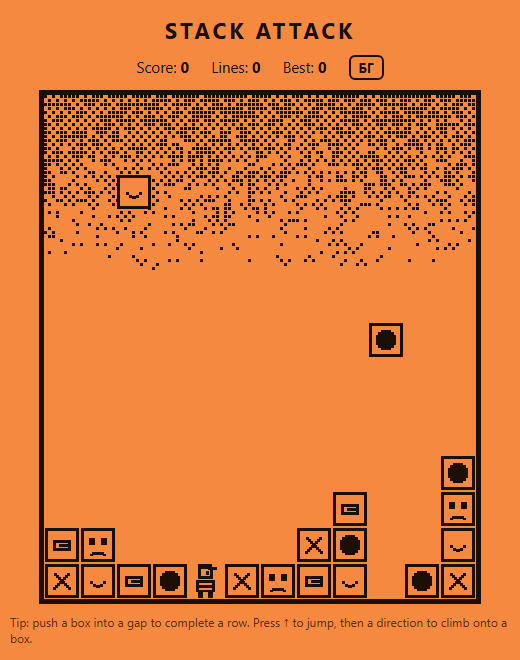

<div align="center">

# 📦 STACK ATTACK

**A retro box-pushing puzzle game in a single HTML file, in the style of the old Siemens mobile phone classic.**

[](https://svetlyobg.github.io/stack-attack/)
&nbsp;

&nbsp;




</div>

---

## 🎮 How to play

Boxes keep dropping from the sky. You're the little worker at the bottom.

- **Push** boxes left and right to fill the gaps.
- **Complete a full row** and it disappears. Everything above drops down.
- **Climb** on top of the stacks by jumping.
- **Don't get crushed!** If a box lands on your head, or the stack reaches the top, it's game over.

The game starts slowly with one box at a time. As you survive, the boxes fall faster and more of them drop at once.

### Controls

| Action | Keyboard | Phone / tablet |
| --- | --- | --- |
| Move / push | `←` `→` or `A` `D` | ◀ ▶ |
| Jump | `↑`, `W` or `Space` | ▲ |
| Climb onto a box | Jump, then press a direction while in the air | ▲ then ◀ / ▶ |
| Pause | `P` | — (auto-pauses when you leave the app) |
| Start / restart | `Enter` | Start button |

### Tips

- 💡 Pushing a box also moves **every box stacked on top of it**, as long as there's room on the other side.
- 💡 To push a box to the **left**, you have to stand on its **right** side. Jump over it first if needed.
- 💡 You can only push while your feet are on something, not mid-jump.
- 💡 Walking into a box that can't be pushed makes you climb onto it automatically.

### Scoring

| Event | Points |
| --- | --- |
| Box lands | +2 |
| Row cleared | +100, plus a bonus of +5 per row cleared so far (up to +100) |

Your best score is saved in the browser.

## 🌍 Languages

The game speaks **English** and **Bulgarian (Български)**. It picks the language from your device the first time you open it. Switch any time with the **EN / БГ** button next to the score.

## 🚀 Run it locally

There's nothing to install or build. Download [`stack-attack.html`](stack-attack.html) and open it in any modern browser.

```bash
git clone https://github.com/svetlyobg/stack-attack.git
cd stack-attack
# then open stack-attack.html in your browser
```

## 🛠 Under the hood

- One self-contained HTML file: plain JavaScript and `<canvas>`, with no libraries and no images.
- All the pixel art (boxes, the worker, the dithered sky) is drawn in code.
- It works with a mouse, keyboard and touch screen, and the layout fits phone screens.
- It's hosted for free on **GitHub Pages**.

---

<div align="center">
<sub>Made with ☕ and a lot of falling boxes.</sub>
</div>
